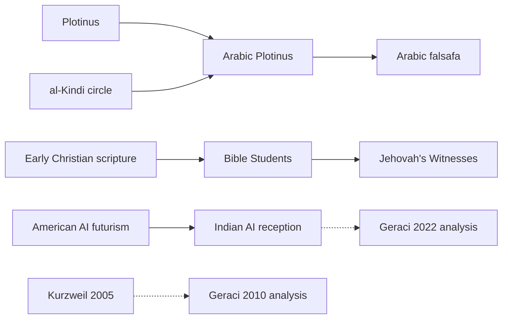

# SCH-01B: passage-level coding and historical influence gate

**Dated 2026-10-30. Status: reproducible protocol, publicly anchored pilot sources, and empty reviewer packets. Independent human reviews have not occurred.** The preceding SCH-01 score came from one investigator's annotations and remains a fixture, not inferential evidence. This phase adds historical provenance before inviting a statistical or metaphysical interpretation.

## Study question and data units

**Primary question:** How often does an abstract three-stage pattern (`deficiency -> transformation -> altered condition`) appear in separately located passages, and how often does it survive when the reader must preserve the causal, temporal, identity, and authority commitments of the passage?

The analysis unit is a *bounded source passage*. `passages.json` currently contains **11 pilot units**: two Kurzweil passages, two Jehovah's Witness passages, Qur'an 14:48, three secondary scholarly proxies for Plotinus, Śaṅkara and Daoism, and three clearly identified synthetic controls. The controls provide implementation and obvious-false-positive checks. The pilot is purposively assembled, not representative. Three historical philosophical cases use secondary exposition because original-language editions have yet to be frozen; those cases must be replaced or source-qualified before a primary-text analysis.

## Review protocol

1. Both coders must first be given the codebook below and the independently shuffled `coder_A.csv` and `coder_B.csv` templates. Distribute only one sheet to each coder, without the researcher-only alias manifest, the earlier SCH-01 fixture, or the research hypothesis predictions. Passage aliases are permuted independently of corpus order to reduce accidental grouping disclosure.
2. Coders read the actual linked paragraphs or verses at `source_url` and `source_locator`. For synthetic cases, `synthetic_text` is the authored input. Source URL visibility makes this **pairing-blinded rather than source-blinded**. The material cannot be fully tradition-blinded without destroying provenance.
3. Each coder supplies a separate value in every axis, plus `confidence` (0–3) and `notes` recording the exact words that justify contested boundaries. No consultation with the other coder during initial work.
4. Each field may be `unknown` or `disputed` when justified. For multiple compatible labels use `multi:label+label` and explain in notes. Unknown and multi-label items are held out of the simple exact-agreement estimate pending adjudication.
5. Freeze both coded CSVs before showing the other coder's labels, disagreements, the earlier fixture outcomes, or any cross-passage matrix.
6. Compute per-axis agreement; report eligible denominator, raw agreement and Cohen's kappa where defined. **A software comparison cannot certify that coders acted independently.** Investigators must record the reviewer assignment, first-pass completion, and provenance of review.
7. Resolve ambiguities in a separately versioned adjudication file, with original answers preserved. Do not suppress disagreements by rewriting the codebook after the fact.

## Field-specific codebook

`stage`: `DTE` (deficiency, intervention/transition, enduring altered state), `cyclic`, `stable`, `other`, `unknown`, or `disputed`. Require evidence for all three elements before assigning `DTE`.

`time`: `future_discontinuity`, `ontological_reversion`, `atemporal_recognition`, `ongoing_return`, `cyclic`, `ongoing_stasis`, `other`, `unknown`, `disputed`. A timeless ontology cannot automatically be coded as future apocalypse.

`agency`: Use the smallest passage-grounded label, such as `divine_intervention`, `technology`, `cultivation`, `contemplation`, `self_knowledge`, `human_operators`, `unspecified`, or `unknown`. A coder may add a new label with evidence in notes; the researcher must record every addition before analysis.

`identity`: Code the asserted continuity mechanism, e.g. `divine_resurrection`, `biological_continuity`, `digital_replication`, `atman_brahman_identity`, `return_of_soul`, `process_continuity`, `unasserted`, `unknown`. Keep resurrection and digital copying distinct.

`ultimate`: Record whether the passage explicitly commits to `transcendent_creator`, `the_one`, `brahman`, `dao`, `unasserted`, `other`, or `unknown`. Identifying these categories as synonyms would itself be a theological claim requiring separate argument.

`destination`: Preserve specifics: `earthly_restoration`, `technological_transformation`, `judgment_new_creation`, `contemplation`, `liberation`, `harmonization`, `mundane_functionality`, `unasserted`, `other`, `unknown`.

`authority`: Code the right to decide or command as separately expressed, e.g. `divine_kingdom`, `divine_judgment`, `human_institution`, `technical_system`, `scripture_reason`, `the_way`, `unasserted`, `unknown`. Capability and legitimate jurisdiction are different questions.

## Graph provenance and limits

`influence_graph.json` contains **16 dated nodes**, **11 supported or interpretive edges**, and **four explicit unanswered exposure questions**. Every edge declares `edge_class`, `status`, its purported mechanism, a source URL, and the scope the citation supports. Only `edge_class=transmission` plus `status=documented` may be traversed by the executable influence-path audit. `scholarly_analysis` links point toward a work that analyzes its subject. `comparison` links describe a scholarly analogy. Neither counts as personal influence.

The graph's six documented transmission/reception edges support paths from Plotinus through Arabic Plotinus to *falsafa*, and from early Christian scripture through the Bible Student movement to present Witness teachings. One community-level route from American AI futurism to Indian reinterpretation is supported by Geraci's 2022 publisher abstract. The latter does not identify an individual who copied a named text. A missing Watch Tower-to-Kurzweil path records the current **absence of documented evidence in this limited ledger**. It cannot prove independent origin.



Solid arrows are documented at the indicated source scope, including broad communal reception. Dashed arrows point to scholarly analysis rather than a historical influence on the author. The diagram omits contested, unknown links on purpose.

## Exact commands

Run in `experiments/sch01_schelling_convergence/` with Python 3.10 or newer:

```bash
python -m unittest discover -s . -p 'test_*.py' -v
python phase2.py graph
python phase2.py prepare --out ./results/local_review_packets
python phase2.py score --coder-a ./results/local_review_packets/coder_A.csv --coder-b ./results/local_review_packets/coder_B.csv
```

`prepare` writes empty coding sheets and `researcher_manifest.json` for the PI. Keep that manifest separate from coders. `score` on untouched templates returns `incomplete_annotations` with no inferred agreement. For publication, store a frozen copy of the original source text where licensing permits, document every excerpt/version, and retain inaccessible sources in a separate uncertainty register.

## Admission gates for SCH-01C

- Replace the Plotinus, Advaita and Daoist secondary proxies with selected original-language passages plus properly identified translations, or scope the claim to secondary scholarly descriptions.
- Register a sampling frame and matched controls, including specific counterfactual destinations and nonapocalyptic analogues, before receiving coding results.
- Recruit qualified independent coders and preserve original annotations. Document inter-rater reliability with honest denominators and the treatment of `unknown`/`disputed`/multi-label cases.
- Perform a dated direct-citation search for the JW/Kurzweil hypothesis. Distinguish direct borrowing from general cultural inheritance; do not equate a failed search with historical independence.
- Freeze the categorical metric, held-out analyses, and null-model assumptions ahead of inference. Keep the metaphysical conjecture explicitly outside any statistical conclusions unless its likelihood model can be defended independently.

**Editorial boundary:** the separate *Divine Elegance* interlude is a proposal. No change is authorized to the canonical manuscript, its E0–E8 commitments, nineteen-chapter structure, or existing RSI interludes.