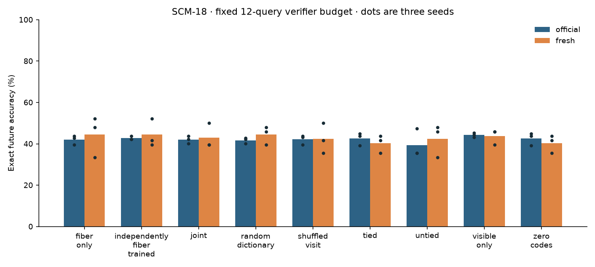
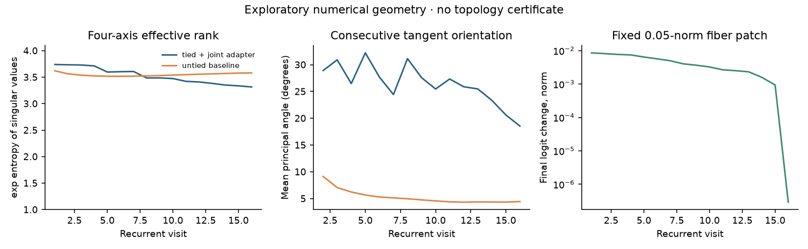
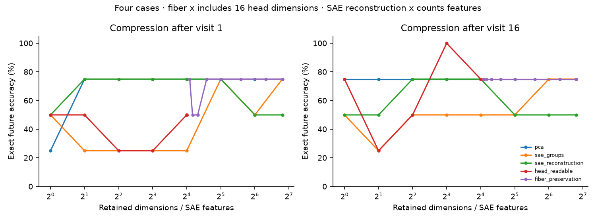
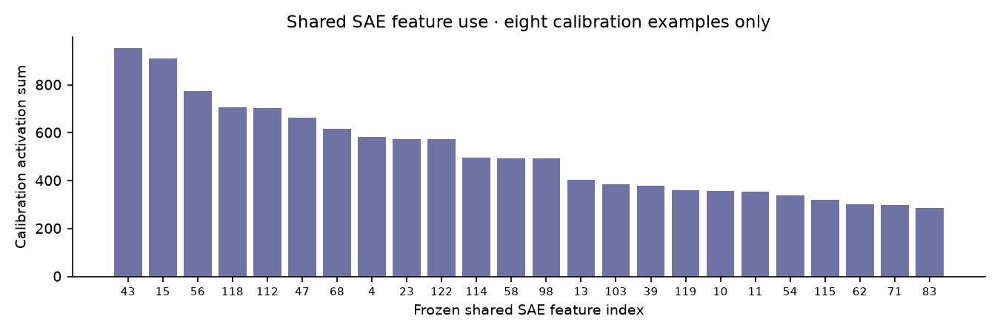

# SCM-18 executed results

**Classification:** local exploratory campaign on newly trained small models. The strict positive-mechanism criterion is not established. No trained RMP transfer or neural topology certificate is claimed.

Completed on 2026-11-14 using Python 3.12.5, PyTorch 2.9.1+cu126, Windows and an RTX 3050 4GB. C: had insufficient space for CUDA wheels; an isolated environment was installed on D:. No existing user files were removed and no cloud compute was used.

## Registered selection and reproduction

The original SCM-15 synthetic CPU smoke scored 8/12 in all four arms. The separate pinned-EvalMath CPU/GPU reproduction used identical initial weight and example hashes and scored 6/12 in every arm; final phase-loss differences were below 3e-7. These short runs validate plumbing, not learning or generalization.

A supplemental instrumented reproduction of the **complete original SCM-15 pinned-EvalMath pipeline** scored 81/192 for tied/zero-code and 80/192 for joint/reversed-gate on both CPU and GPU. Initial weights, generated public challenge hashes, exact scores and work counts matched: 795 model calls, 825 example-forwards, 3,300 recurrent example-visits and 10 optimizer steps per run. Its tiny fit is an engineering reproduction; it does not establish an adapter improvement. It runs only after the main campaign freeze.

Development screening selected 16 visits and rank 4. Visit screen exact scores were 4: 26/48, 8: 23/48, 16: 28/48. Three seeds (181, 1181, 2181) then ran four registered objectives. The selected tied model has 138,800 total parameters (108,384 base, 28,912 SAE, 1,504 adapter); the untied comparator has 1,662,560 total parameters. All checkpoints, SAE dictionaries, calibration bases and source hashes were frozen before the separately launched final evaluator opened the official roster. Official-roster calls before freeze: 0.

## Exact mathematical outcomes

Mean percentages below use three seeds. Official evaluation has 192 cases per seed (including public collision pairs and negatives); fresh OOD evaluation has 48 cases from four unused source families. Neither set consists of 192/48 independent mathematical families. Every neural arm has a maximum budget of 12 exact candidate checks.

| Objective | Policy | Official % | Fresh OOD % | Official top-1 correct by seed |
|---|---|---:|---:|---|
| causal_consistency | fiber_only | 41.32 | 44.44 | [9, 9, 7] |
| causal_consistency | independently_fiber_trained | 40.28 | 43.75 | [10, 12, 7] |
| causal_consistency | joint | 42.36 | 47.92 | [8, 6, 5] |
| causal_consistency | random_dictionary | 43.40 | 45.14 | [7, 8, 7] |
| causal_consistency | shuffled_visit | 42.88 | 45.14 | [10, 6, 5] |
| causal_consistency | tied | 43.23 | 47.92 | [7, 11, 6] |
| causal_consistency | visible_only | 44.97 | 45.83 | [5, 7, 4] |
| causal_consistency | zero_codes | 43.23 | 47.92 | [7, 11, 6] |
| final | fiber_only | 42.01 | 44.44 | [7, 7, 7] |
| final | independently_fiber_trained | 42.71 | 44.44 | [10, 7, 8] |
| final | joint | 42.01 | 43.06 | [13, 6, 7] |
| final | random_dictionary | 41.67 | 44.44 | [7, 7, 8] |
| final | shuffled_visit | 42.19 | 42.36 | [13, 5, 7] |
| final | tied | 42.53 | 40.28 | [6, 2, 7] |
| final | untied | 39.41 | 42.36 | [7, 7, 7] |
| final | visible_only | 44.27 | 43.75 | [5, 2, 7] |
| final | zero_codes | 42.53 | 40.28 | [6, 2, 7] |
| intermediate | fiber_only | 40.28 | 47.22 | [7, 11, 6] |
| intermediate | independently_fiber_trained | 40.45 | 47.22 | [5, 9, 5] |
| intermediate | joint | 40.62 | 48.61 | [7, 9, 6] |
| intermediate | random_dictionary | 41.32 | 45.14 | [5, 8, 6] |
| intermediate | shuffled_visit | 40.28 | 48.61 | [7, 9, 6] |
| intermediate | tied | 40.97 | 43.06 | [11, 7, 6] |
| intermediate | visible_only | 40.97 | 43.75 | [9, 8, 4] |
| intermediate | zero_codes | 40.97 | 43.06 | [11, 7, 6] |
| sae_regularized | fiber_only | 43.23 | 38.19 | [5, 11, 7] |
| sae_regularized | independently_fiber_trained | 41.49 | 39.58 | [6, 7, 7] |
| sae_regularized | joint | 41.67 | 40.28 | [7, 11, 7] |
| sae_regularized | random_dictionary | 41.67 | 37.50 | [7, 8, 5] |
| sae_regularized | shuffled_visit | 41.84 | 38.89 | [7, 11, 7] |
| sae_regularized | tied | 42.71 | 43.75 | [4, 13, 7] |
| sae_regularized | visible_only | 40.62 | 44.44 | [5, 12, 6] |
| sae_regularized | zero_codes | 42.71 | 43.75 | [4, 13, 7] |

Final-only joint minus tied, official percentage points by seed: [-1.0416666666666685, 1.0416666666666685, -1.5625]; fresh: [8.333333333333332, -4.166666666666669, 4.1666666666666625]. No significance or family-transfer mechanism follows from this small comparison. The full receipt retains each task outcome, false-future acceptance and actual query count. Visible-only, fiber-only, reversed gates and zero codes are inference ablations of the joint checkpoint; independently fiber-trained and random-dictionary entries are separate fits. Zero-code arithmetic equals the tied baseline.



## Causal structure and compression

Four-axis effective rank ranged from 1.775 to 3.998 over two step sizes, visits and 16 confirmation cases. This rank is capped at four by the intervention design and does not estimate full hidden rank. Principal angles, head-sector energy, support changes and finite-difference curvature are numerical diagnostics. The untied model uses the same frozen intervention axes and expanded visits, with more physical parameters.

A 0.05-norm fiber patch after the first visit changed final-logit norms by 0.00795–0.00962; after the final visit, changes were 3.78e-07–7.04e-07. This is a numerical transport effect in a deliberately linear-bottleneck model.

The named first-operator interchange test had **0/16 valid clean recipient/donor pairs**. Causal fidelity is null because no eligible clean pairs existed. Raw attempted-pair success and the full-state swap control remain separate in the receipt. These tests do not establish that a low-dimensional intervention preserves a correctly identified intermediate reasoning process.

A separate **post-final exploratory audit** repeats the same sixteen mathematical pairs across all three frozen final-only seeds using native, already-trained directions. No new direction search or model selection is performed. Patch norms differ across head/fiber sectors and are recorded. The denominators are model/pair eligibility counts on sixteen shared pairs, not independent sets of sixteen per seed.

Of the sixteen shared pairs, 14 have differing oracle futures and public encoded inputs. All seeds failed the both-clean-correct eligibility gate, so semantic fidelity could not be estimated.

| Seed | Eligible / 16 | Visit-1 native write fiber fidelity | Visit-1 SAE/VPD fiber fidelity | Visit-1 full-state control |
|---:|---:|---:|---:|---:|
| 181 | 0 | undefined | undefined | undefined |
| 1181 | 0 | undefined | undefined | undefined |
| 2181 | 0 | undefined | undefined | undefined |

Compression was tested after every visit at requested dimensions 1/2/4/8/16/32/64/112 on four independent confirmation examples. That sample is too small to identify a general smallest sufficient subspace. SAE curves count selected features; fiber curves preserve the head-readable space in addition to the selected fiber directions. Full-dimensional PCA is an identity control up to FP32 roundoff.

These are direct state projections/reconstructions; no separate norm-restoration or manifold-matching control is fitted. Accuracy changes can therefore reflect state-distribution or norm shifts as well as information removal.

The additional `interchange_methods.json` audit covers PCA, SAE groups, SAE reconstruction, head-readable projection, fiber preservation and native SAE-conditioned VPD correction differences. It uses the same frozen calibration frame and validity criterion. All six families report null fidelity when no eligible pairs exist. This extra audit was specified after development and did not change model selection.







## Positive, negative and unresolved findings

| Question | Executed finding | Interpretation |
|---|---|---|
| CPU/GPU reproducibility | Same initial weights/examples, same exact scores | Engineering pass |
| Final head fiber | Final-visit linear-head effects near FP32 noise; earlier effects measured | Causal logit transport, not semantic proof |
| Low-rank adapter skill gain | Per-seed outcomes and matched controls above | Exploratory; strict positive criterion not met |
| Named variable mediation | 0/16 eligible pairs | Limited/absent causal evidence |
| Nonlinear RMP transfer | Missing checkpoint, integrity receipt, selected dictionary and monitor bundle; tracked metadata retrieved | Not executed; existing gate preserved |
| Final-process interruption | Lost combined receipt during a tool refresh; identical frozen matrix recovered with durable per-dataset receipts | Failed-attempt compute has an explicit accounting gap |
| SCM-12/13 topology | Conditional surrogate routines invoked on sampled projections | Neural conclusion inconclusive without continuum bounds |

## Resource accounting and limits

Recorded completed-run peak PyTorch allocation: **49.28 MiB**; reservation: **56.00 MiB**. Minimum sampled device-free memory: **3183.70 MiB**. The 3000 MiB allocator cap and every-forward memory checks preserved the registered 500 MiB headroom at all samples. Memory outside the PyTorch allocator is included in device-free samples; continuous headroom is not certified. Peaks in receipts are process-cumulative, not isolated per-stage maxima.

Main campaign work totals (screening + training + calibration + final evaluation + diagnostics):

```json
{
  "adapter_optimizer_steps": 4800,
  "base_optimizer_steps": 4080,
  "forward_examples": 122211,
  "model_calls": 43412,
  "paid_candidate_queries": 265860,
  "readout_examples": 295011,
  "recurrent_example_visits": 1916016,
  "sae_optimizer_steps": 960
}
```

Original reproduction receipts are additional work and are excluded from these totals. Independent-oracle make_case/check_candidate/grade/roster requests are recorded; grade performs an internal acceptance recheck. Recovery memoizes pure integer execute results on CPU without changing the oracle source, evaluator, cases or budgets. Logical execute requests, physical exact cache misses and cache hits are separate in `final.json/recovery`. Cached-oracle wall times cannot be used as fair per-arm timing comparisons. Paid search budgets remain separate. Backward work is counted as optimizer steps rather than estimated FLOPs. Causal adapter training uses two additional forwards per update, so training cost is not equal across objectives. SAE dictionary updates operate on CPU-cached frozen training activations.

The original final process disappeared during a tool refresh before writing its combined receipt. Its 32 observed completed checkpoint summaries imply 20,172–24,354 additional example-forwards; its exact verifier count and peak memory are unavailable. **Whole-campaign compute accounting is incomplete for that failed attempt.** The completed replacement matrix has exact per-dataset counts and uses the same frozen models/source manifest. `recovery_amendment.json` records the performance-only change. Progress receipts permit restarting without discarding completed datasets.

Private weights and new challenge gold remain outside Git. Public hashes alone are not access-control guarantees: isolation here is an audited program/data-flow boundary on one local machine. No historically sealed RMP evaluation was opened.

The scope is a four-token public-feature program classifier trained for 240 base updates per fit on 384 generated cases, with a deliberately rank-16 readout. Different source programs can share observed behavior, so source-program cross entropy and exact mathematical correctness measure different things. These finite-budget results leave the broader low-dimensional reasoning hypothesis unresolved. Automatic hosted workflows are intentionally skipped at publication; all validation and experiments for this campaign ran locally.
