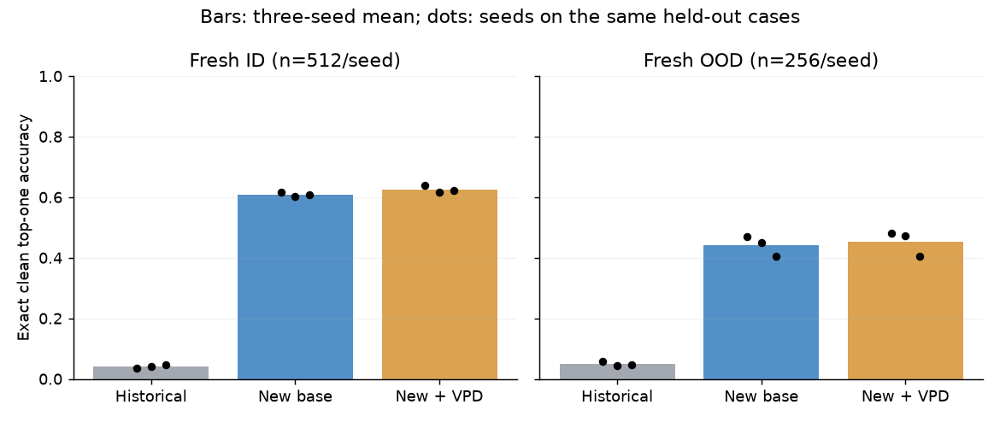
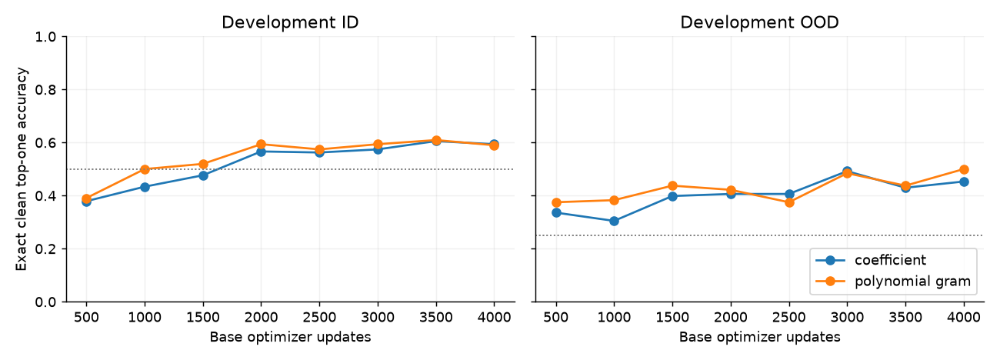
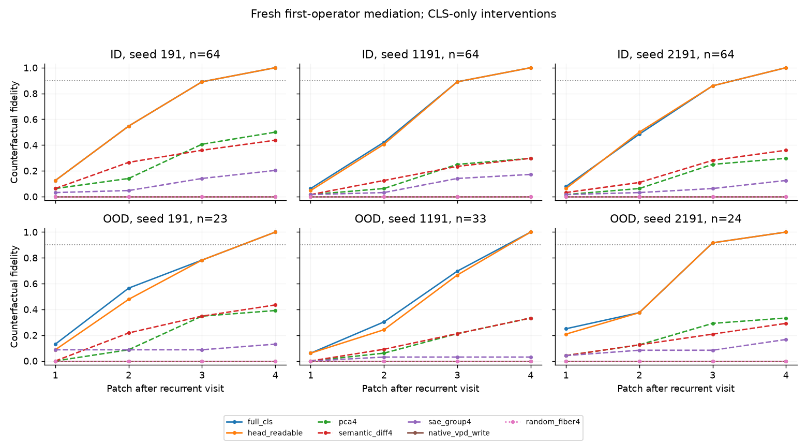
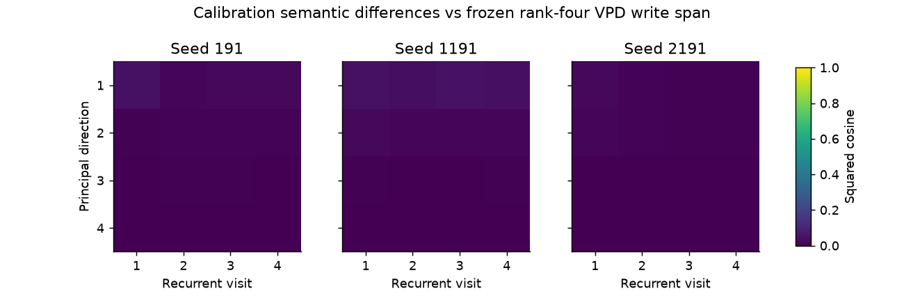

# SCM-19 results: clean acquisition and fresh semantic mediation

Preregistered commit `a94d749`; selected `coefficient` at 4000 base updates per seed. The registered robust primary criterion did not pass.

Clean acquisition improved: three-seed mean ID top-one accuracy rose from 4.1% for the frozen historical baseline to 60.9% for the new base and 62.6% with VPD. OOD means were 4.9%, 44.1% and 45.3%. Actual rank-four VPD-write mediation was 0/64 ID in every seed and 0/23, 0/33, 0/24 OOD, matching the zero-success random controls. This is a substantive negative result on the eligible ID subset; two OOD seeds also miss the registered eligibility minimum.

## Clean mathematical accuracy

Each entry is one neural argmax over 64 programs, followed by exact prefix and withheld-future grading. No verifier/search chooses the prediction. Historical SCM-18 frozen baselines are evaluated on these same fresh cases. Seeds share cases; seed results are not independent case samples.

| Seed | Split | n | Historical correct | New base correct | New + VPD correct | Base zero-visit correct |
|---:|:---|---:|---:|---:|---:|---:|
| 191 | ID | 512 | 18 (3.5%) | 316 (61.7%) | 327 (63.9%) | 34 |
| 191 | OOD | 256 | 15 (5.9%) | 120 (46.9%) | 123 (48.0%) | 10 |
| 1191 | ID | 512 | 21 (4.1%) | 309 (60.4%) | 316 (61.7%) | 36 |
| 1191 | OOD | 256 | 11 (4.3%) | 115 (44.9%) | 121 (47.3%) | 14 |
| 2191 | ID | 512 | 24 (4.7%) | 311 (60.7%) | 318 (62.1%) | 45 |
| 2191 | OOD | 256 | 12 (4.7%) | 104 (40.6%) | 104 (40.6%) | 17 |

Three-seed means: ID historical 4.1%, new base 60.9%, VPD 62.6%; OOD historical 4.9%, new base 44.1%, VPD 45.3%.

The zero-visit diagnostic uses the trained input projection and head without recurrent updates. It helps assess how much accuracy the input representation alone supplies. It is a prespecified ablation, not another candidate search. Family breakdowns and false future acceptances are retained in `results/summary.json` and raw score receipts.

## Registered semantic endpoint

The first source operator changes I→N→S→R→I, with identical input series, topology and other operators. Eligibility requires both exact clean predictions to be correct. Only the first 64 eligible pairs per split are assayed. The primary endpoint patches the actual SAE-conditioned VPD write on CLS after visit two; the rank-four random fiber patch has the same per-pair norm.

| Seed | Policy | Split | Eligible / attempted | Assayed | VPD correct / n | Random correct / n | Registered positive |
|---:|:---|:---|---:|---:|---:|---:|:---|
| 191 | adapter | ID | 94/256 | 64 | 0/64 (0.0%) | 0/64 (0.0%) | no |
| 191 | adapter | OOD | 23/128 | 23 | 0/23 (0.0%) | 0/23 (0.0%) | no |
| 191 | base | ID | 94/256 | 64 | 0/64 (0.0%) | 0/64 (0.0%) | no |
| 191 | base | OOD | 23/128 | 23 | 0/23 (0.0%) | 0/23 (0.0%) | no |
| 1191 | adapter | ID | 104/256 | 64 | 0/64 (0.0%) | 0/64 (0.0%) | no |
| 1191 | adapter | OOD | 33/128 | 33 | 0/33 (0.0%) | 0/33 (0.0%) | no |
| 1191 | base | ID | 101/256 | 64 | 0/64 (0.0%) | 0/64 (0.0%) | no |
| 1191 | base | OOD | 33/128 | 33 | 0/33 (0.0%) | 0/33 (0.0%) | no |
| 2191 | adapter | ID | 107/256 | 64 | 0/64 (0.0%) | 0/64 (0.0%) | no |
| 2191 | adapter | OOD | 24/128 | 24 | 0/24 (0.0%) | 0/24 (0.0%) | no |
| 2191 | base | ID | 106/256 | 64 | 0/64 (0.0%) | 0/64 (0.0%) | no |
| 2191 | base | OOD | 24/128 | 24 | 0/24 (0.0%) | 0/24 (0.0%) | no |

A robust positive requires all three seeds, at least 64 eligible ID / 32 eligible OOD pairs, ≥90% fidelity, ≥15 percentage-point advantage over random, and ≤2 percentage-point clean accuracy loss in each split. Secondary methods and visits cannot replace a failed primary endpoint. A zero denominator is undefined. Wilson intervals in the summary are descriptive, without multiplicity correction.

Full CLS at visit four is the donor-readout positive control. Sham and terminal head-fiber patches are null controls. All outcomes and per-pair norms are retained in the mediation receipts and replayed by the independent audit. The native write span is a global rank-four intervention on CLS, not four coordinates at every token.

## Resource and integrity checks

Local RTX 3050 4GB, FP32, batch eight, four tied visits. Peak allocated 40.90 MiB; peak reserved 52.00 MiB; minimum sampled free 3223.7 MiB. Allocation cap 3000 MiB; required free headroom 500 MiB. Active worker time approximately 7.13 minutes, excluding the recovery handoff.

16,000 base, 1,200 SAE and 1,200 adapter updates; 24,776 model calls; 197,568 example forwards; 822,528 recurrent example-visits; 21,219,072 recurrent token-visits; 202,176 readout examples. Cumulative check/grade calls are exact from the journal. Recovery-process source-request and physical-cache counts and the first data-preparation checkpoint are in `completed.json`; the interrupted process's post-data pure-function/cache counters were not durably recorded and are excluded from complete cumulative claims. Pure integer caching does not change mathematical outcomes. See `RECOVERY.md` for the logging-only exception and preregistered recovery. No training or scientific method changed.

Independent audit regraded 28,672 recorded predictions and checked 480 mediation cells, frozen model/dictionary/frame hashes, 1,536 fresh unique signatures, freeze chronology and journal totals. Eight unit tests passed, including the logger recovery regression. Official EvalMath roster calls: zero. No training occurred after the final freeze. Heavy checkpoints, optimizer state, work journal and fresh gold stay private outside Git.

The two encodings have different parameter and preprocessing costs (231,120 coefficient versus 1,111,376 polynomial-Gram parameters). They are acquisition alternatives, not parameter-matched causal evidence. Within a selected frozen model, patch methods share the same cases, model and four-visit prediction budget; projection arithmetic differs. Adapter and base evaluate the same architecture, with zero codes disabling the base adapter.

## Interpretation and limits

The acquisition changes combine more training data and updates, richer public coefficient features, a larger four-visit model, and verified equivalent-program labels. This follow-up establishes the combined effect; it does not isolate a single cause of improvement. The polynomial arm supplies explicit generic mathematical preprocessing, and neither arm establishes raw-text mathematical reasoning.

Mediation is conditional on clean eligibility and on a specified finite formal-series DSL. A successful full-state or PCA patch is evidence about that intervention and eligible subset, not proof that a unique semantic variable has been isolated. Calibration subspace overlap is descriptive geometry. No continuum, braid, curvature or topology certificate is claimed.
