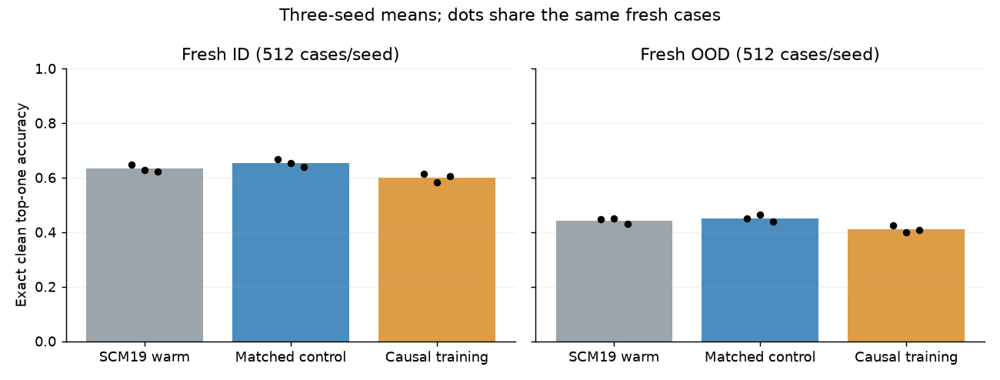
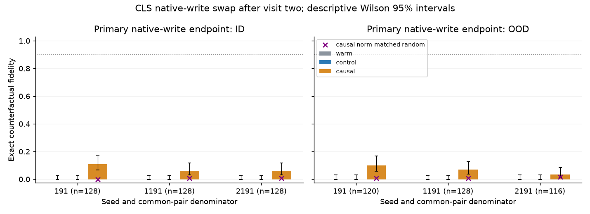
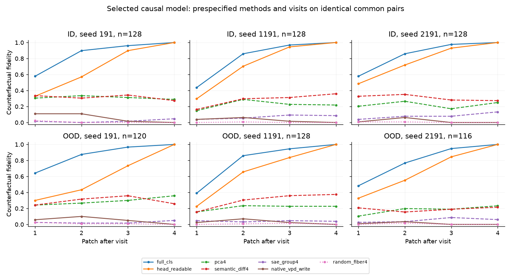
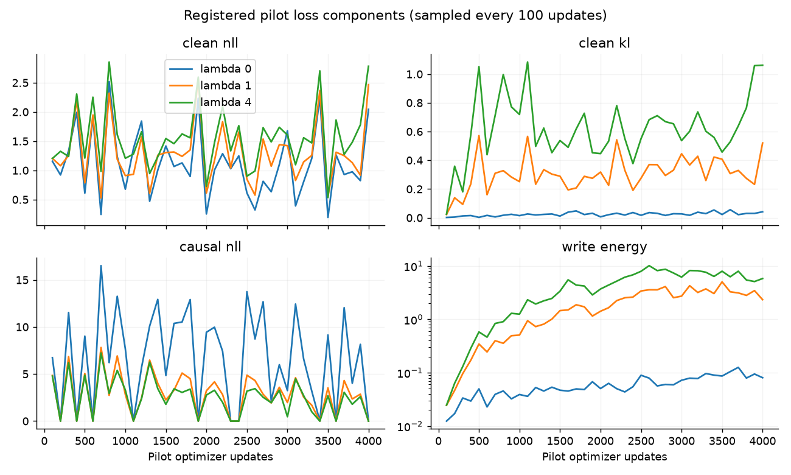

# SCM-20 results: causal consistency and clean preservation

Preregistered commit `179c01d`. Promoted causal checkpoint: True; lambda 1.0, common update budget 4000. The registered robust positive criterion did not pass.

Fresh clean preservation failed in 5/6 seed-by-split comparisons; the worst causal-model change versus its warm start was -5.1 percentage points. Any mediation gain must be interpreted together with those clean losses and the prespecified fidelity/control thresholds.

## Clean top-one mathematics

All entries use one neural argmax and independent exact post-prediction grading, without search or verification to choose a program. Warm means the frozen SCM-19 adapter; control uses the identical training objective and three-forward computation with causal coefficient zero. Each model sees the same 512 ID / 512 OOD fresh clean cases. Seeds share these cases, so their scores are not independent case samples.

| Seed | Split | Warm | Matched control | Causal | Causal change | Clean preserved |
|---:|:---|---:|---:|---:|---:|:---|
| 191 | ID | 331/512 (64.6%) | 341/512 (66.6%) | 314/512 (61.3%) | -3.3 pp | no |
| 191 | OOD | 229/512 (44.7%) | 230/512 (44.9%) | 218/512 (42.6%) | -2.1 pp | no |
| 1191 | ID | 322/512 (62.9%) | 334/512 (65.2%) | 299/512 (58.4%) | -4.5 pp | no |
| 1191 | OOD | 231/512 (45.1%) | 238/512 (46.5%) | 205/512 (40.0%) | -5.1 pp | no |
| 2191 | ID | 318/512 (62.1%) | 327/512 (63.9%) | 310/512 (60.5%) | -1.6 pp | yes |
| 2191 | OOD | 220/512 (43.0%) | 224/512 (43.8%) | 209/512 (40.8%) | -2.1 pp | no |

## Development-only checkpoint choice

All six registered causal candidates are shown, including rejected checkpoints. The warm development baseline is fixed before updates. The lambda-zero pilot runs to 4,000 updates and provides the checkpoint at the selected budget; its selection-evaluation cost differs from the causal pilots.

| Lambda | Step | ID clean | OOD clean | Clean gate | ID native / random | OOD native / random |
|---:|---:|---:|---:|:---|---:|---:|
| 1 | 1000 | 58.6% | 38.3% | reject | 1.6% / 0.0% | 0.0% / 0.0% |
| 1 | 2000 | 58.8% | 39.1% | reject | 4.7% / 0.0% | 3.7% / 0.0% |
| 1 | 4000 | 59.8% | 41.6% | pass | 21.9% / 3.1% | 16.0% / 2.0% |
| 4 | 1000 | 52.1% | 36.1% | reject | 0.0% / 0.0% | 2.3% / 0.0% |
| 4 | 2000 | 55.3% | 37.1% | reject | 6.2% / 0.0% | 3.8% / 3.8% |
| 4 | 4000 | 52.0% | 36.7% | reject | 29.5% / 1.6% | 23.4% / 2.1% |

## Primary causal-consistency confirmation

The first program operator is cycled while inputs, topology and the other operators stay fixed. Generation never uses model correctness. Eligibility requires recipient and donor to be exact-clean-correct under warm, control and causal models. The first 128 common-eligible pairs per split are assayed; all compared models use identical pair IDs. Own eligibility, common counts, selected predictions and outcomes are preserved in raw receipts.

| Seed | Split | Common / attempted | Assayed | Warm native | Control native | Causal native | Causal random | Positive |
|---:|:---|---:|---:|---:|---:|---:|---:|:---|
| 191 | ID | 152/512 | 128 | 0/128 | 0/128 | 14/128 (10.9%) | 0/128 (0.0%) | no |
| 191 | OOD | 120/1024 | 120 | 0/120 | 0/120 | 12/120 (10.0%) | 1/120 (0.8%) | no |
| 1191 | ID | 156/512 | 128 | 0/128 | 0/128 | 8/128 (6.2%) | 1/128 (0.8%) | no |
| 1191 | OOD | 142/1024 | 128 | 0/128 | 0/128 | 9/128 (7.0%) | 1/128 (0.8%) | no |
| 2191 | ID | 152/512 | 128 | 0/128 | 0/128 | 8/128 (6.2%) | 1/128 (0.8%) | no |
| 2191 | OOD | 116/1024 | 116 | 0/116 | 0/116 | 4/116 (3.4%) | 2/116 (1.7%) | no |

A robust positive requires all seeds and both splits: ≥64 common-eligible pairs, ≥90% native-write fidelity, ≥15 percentage points over each of norm-matched random, warm native and matched-control native, and ≤2 percentage-point fresh clean loss versus warm. Selection must have promoted a candidate. Undefined fidelity at zero tests is not zero. Secondary directions/visits cannot rescue the primary endpoint. Wilson intervals are descriptive and unadjusted; no pooled independent-seed inference is made.

Every intervention acts only on CLS. Native writes lie in the same learned rank-four global head-fiber write span; random fiber patches match their norm separately for every pair/model/visit. Full CLS at the last visit is the donor-readout positive control. Sham and terminal fiber interventions are null controls. All controls are checked by independent exact replay.

## Training and resource accounting

A sampled causal-loss value of zero can mean that no training pair in that batch passed the fixed warm-start eligibility mask. It does not imply perfect causal prediction. Per-update eligible counts are in the journal.

Only 1,552 adapter parameters per model were eligible for updates; the 231,120-parameter model, SAE and projector architecture were fixed. Protected frozen parameter hashes match the SCM-19 warm starts. All pilots, including unused updates/checkpoints, count toward 28,000 adapter updates, 106,162 model calls, 512,762 example forwards, 2,051,048 recurrent example-visits and 55,378,296 recurrent token-visits. Each training update runs three forward/backward paths; development-selection evaluation costs are separately included, so end-to-end compute is not claimed identical between arms.

Local RTX 3050 4GB, FP32, batches ≤8, four visits. Peak allocated/reserved 24.48/30.00 MiB; minimum sampled free 3245.7 MiB; active worker time 47.74 minutes. Enforced 3000 MiB allocation cap and 500 MiB free-headroom guard. No package installation, cloud compute or official EvalMath roster access.

Eight unit tests pass. Independent audit regraded 126,624 recorded predictions, checked 720 mediation cells and 4,096 unique fresh signatures, verified protected weights/checkpoints/directions, common eligibility and pair identity, matched random norms, freeze chronology and cumulative journal/evaluator totals. Complete pure-source/cache counters and continuous journals are available. Worker totals above exclude this separate CPU replay; its own oracle/cache counts are in `audit.json`. No training followed final freeze. Weights, optimizer/RNG states, data cache, raw gold and journal remain private outside Git.

## Scope and limitations

This is a finite formal-series DSL and an explicitly supervised interchange task. Improved fidelity, if observed, demonstrates the tested intervention function on a clean-eligible subset; it does not establish a unique internal semantic variable, natural-language mathematical reasoning, or a topology/continuum certificate. The shared SAE and core were already trained in SCM-19. Development-selected loss/checkpoint results are not independent confirmation.

The inherited OOD generator couples family and topology: rational/fork, squared/cascade, lacunary/additive and twisted_product/hadamard. Larger pools improve eligibility for these four combinations; they do not cover all family-by-topology combinations. Family results are in the summary. Signature deduplication removes identical public problems, not every algebraically equivalent program or structurally related task. Common eligibility reduces selection differences between models but restricts the population further.

The post-hoc actual-encoder audit found 0/512 ID and 1/512 OOD clean cases with a demonstration encoding already present in its pre-final reference set; at least one encoded side overlapped for 2/512 ID and 0/1024 OOD pairs. Public signatures include query coefficients, whereas the model ignores the query. This diagnostic leaves the registered primary sample intact; encoded equality is not by itself equality of withheld futures or gold programs. Full scope and IDs are retained in `audit.json`.
